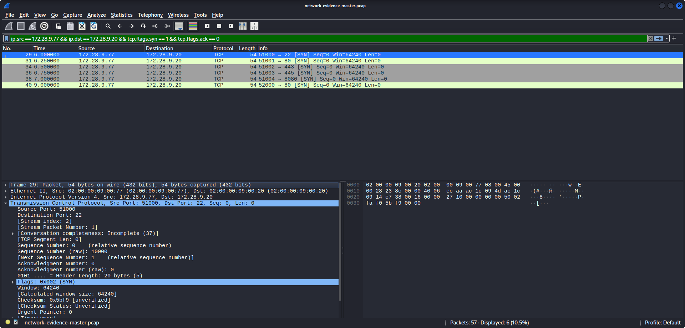
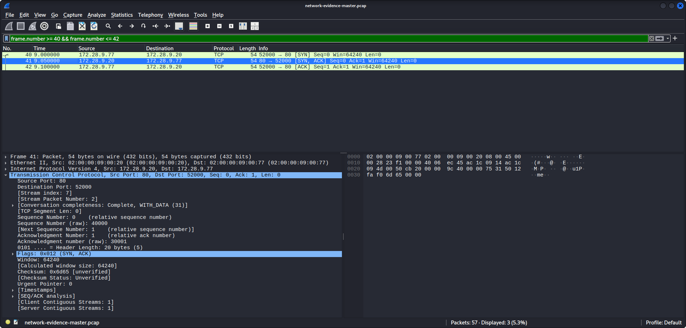
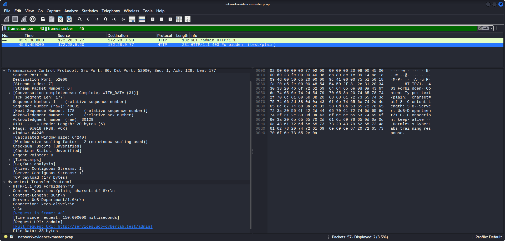
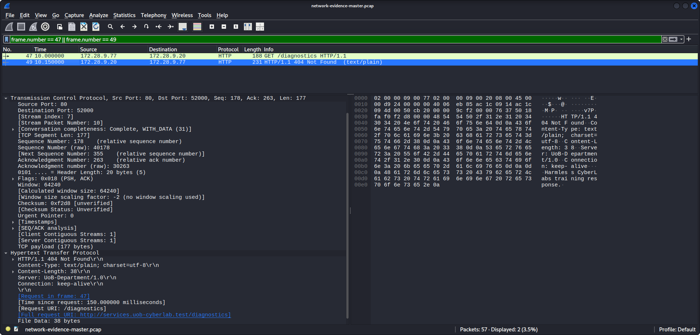
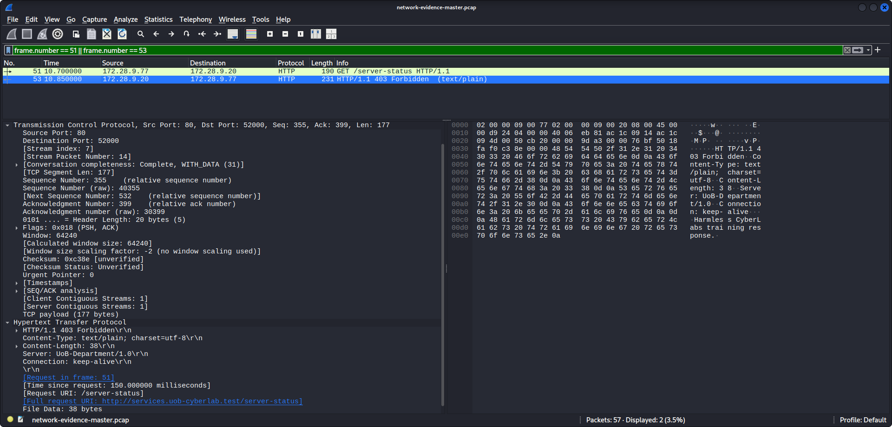

# LAB-09 — Network Forensic Investigation Report

## 1. Executive Summary

This investigation analyzed a 57-packet network capture to identify and assess suspicious activity targeting a web server in a controlled cybersecurity training environment.

The analysis identified network reconnaissance indicators originating from 172.28.9.77 and directed toward 172.28.9.20. The observed activity included TCP connection attempts to multiple ports, a successful TCP three-way handshake on port 80, and HTTP requests targeting /admin, /diagnostics, and /server-status.

The server returned HTTP 403 Forbidden and 404 Not Found responses. Inspection of the three HTTP response bodies did not reveal sensitive administrative or diagnostic information.

Based on the available packet evidence, the activity is consistent with network and web reconnaissance. No successful compromise or data exfiltration was established.

These conclusions are limited to the traffic recorded in the supplied PCAP file.

## 2. Investigation Scope & Evidence Integrity

### 2.1 Investigation Scope

The investigation focused on network traffic captured in the LAB-09 controlled training environment.

The primary objectives were to:

- Identify the source and destination of suspicious network activity.
- Examine TCP connection attempts and HTTP requests.
- Reconstruct the sequence of relevant network events.
- Assess whether the available evidence supports successful unauthorized access or data exfiltration.

The investigation was limited to packet-level evidence. Host logs, endpoint telemetry, and server-side application logs were not available for analysis.

### 2.2 Evidence Inventory

| Evidence File | Description |
|---|---|
| network-evidence-master.pcap | Original network packet capture containing 57 packets |
| network-evidence-master.pcap.sha256 | Recorded SHA-256 checksum for the PCAP |
| network-investigation-record.csv | Analyst-generated investigation timeline and findings |

### 2.3 Evidence Integrity Verification

The original PCAP file was verified against its accompanying SHA-256 checksum file using the following command:

`sha256sum -c network-evidence-master.pcap.sha256`

Verification result:

`network-evidence-master.pcap: OK`

This confirms that the PCAP matched the supplied checksum at the time of verification. It does not independently establish the original provenance of the capture.

### 2.4 Investigation Limitations

- Findings are limited to the 57 packets contained in the provided capture.
- Source IP addresses do not establish the identity of individual users.
- HTTP status codes alone do not prove the overall security state of the server.
- The absence of observed compromise or exfiltration does not prove that neither occurred outside the captured traffic.

## 3. Network Analysis & Event Timeline

### 3.1 Network Entities

The investigation identified the following relevant IPv4 addresses:

| IP Address | Observed Role |
|---|---|
| 172.28.9.77 | Source of suspicious TCP probes and HTTP requests |
| 172.28.9.20 | Destination web server |
| 172.28.9.53 | DNS responder |
| 172.28.9.10 | Additional network client |
| 172.28.9.11 | Additional network client |

These roles are based on observed network traffic and do not establish device ownership or user identity.

### 3.2 Chronological Timeline

| Relative Time | Frames | Event | Assessment |
|---|---|---|---|
| 6.00-7.04s | 29-39 | TCP SYN probes targeting ports 22, 80, 443, 445, and 8080 | Consistent with port scanning |
| 9.00-9.10s | 40-42 | TCP three-way handshake completed on port 80 | TCP connection established |
| 9.30-9.45s | 43, 45 | GET /admin followed by HTTP 403 | Requested resource access denied |
| 10.00-10.15s | 47, 49 | GET /diagnostics followed by HTTP 404 | Requested resource not found |
| 10.70-10.85s | 51, 53 | GET /server-status followed by HTTP 403 | Requested resource access denied |

Times are relative to the beginning of the packet capture.

### 3.3 TCP Reconnaissance

Frames 29-39 show TCP connection attempts from 172.28.9.77 to multiple destination ports on 172.28.9.20.

This pattern is consistent with port reconnaissance. However, the available packets do not establish the intent or identity of the source.

### 3.4 TCP Connection Establishment

Frames 40-42 show a completed TCP three-way handshake:

1. SYN from 172.28.9.77 to 172.28.9.20.
2. SYN-ACK from 172.28.9.20 to 172.28.9.77.
3. ACK from 172.28.9.77 to 172.28.9.20.

This establishes successful TCP connectivity on port 80, not successful exploitation.

### 3.5 HTTP Endpoint Enumeration

Three HTTP GET requests targeted administrative or diagnostic-style paths:

- /admin: HTTP 403 Forbidden
- /diagnostics: HTTP 404 Not Found
- /server-status: HTTP 403 Forbidden

The inspected response bodies contained the text:

`Harmless CyberLabs training response.`

The responses also included the HTTP header:

`Server: UoB-Department/1.0`

The server header reveals a server-identifying string, but its accuracy and security implications cannot be established from the header alone.

No sensitive administrative or diagnostic content was observed in these three responses.

## 4. Security Findings & Incident Assessment

### 4.1 Finding F-01: TCP Port Reconnaissance

**Evidence:** Frames 29-39

Multiple TCP SYN probes originated from 172.28.9.77 and targeted ports 22, 80, 443, 445, and 8080 on 172.28.9.20.

**Assessment:** The observed pattern is consistent with TCP port reconnaissance.

**Confidence:** High for the observed activity. The source's intent remains unknown.

### 4.2 Finding F-02: HTTP Endpoint Enumeration

**Evidence:** Frames 43, 45, 47, 49, 51, and 53

The source requested three paths: /admin, /diagnostics, and /server-status.

The server responded with HTTP 403, 404, and 403 respectively.

**Assessment:** The requests are consistent with web endpoint enumeration. No successful access to protected resources was demonstrated.

**Confidence:** High for the requests and responses.

### 4.3 Finding F-03: HTTP Server Header Disclosure

**Evidence:** Frames 45, 49, and 53

The HTTP responses included the header:

`Server: UoB-Department/1.0`

**Assessment:** A server-identifying string was exposed. The available evidence does not establish that the string represents the actual server software or that its disclosure constitutes an exploitable vulnerability.

**Confidence:** High for the observed header.

### 4.4 Incident Classification

**Classification:** Suspected Network and Web Reconnaissance

**Successful compromise:** Not established.

**Data exfiltration:** Not observed in the analyzed traffic.

**Attribution:** The source IP address was identified, but the individual or system operator responsible could not be determined.

**Severity:** Undetermined. The capture supports reconnaissance indicators, but a reliable operational severity rating would require additional context, including asset criticality, authorization, and host-level evidence.

### 4.5 Overall Assessment

The available evidence supports a sequence of TCP probing followed by HTTP requests to administrative and diagnostic-style paths.

A TCP connection to port 80 was successfully established, but the inspected HTTP responses did not reveal sensitive administrative or diagnostic information.

The investigation did not establish successful exploitation, unauthorized access to protected resources, or data exfiltration.

These findings apply only to the supplied network capture.

## 5. Security Recommendations

### 5.1 Network Reconnaissance Detection

Monitor repeated TCP connection attempts targeting multiple ports on the same host.

Configure appropriate IDS/IPS alerts and correlate suspicious network activity with firewall logs.

### 5.2 Administrative Endpoint Protection

Restrict access to administrative endpoints such as /admin using strong authentication, authorization, and network access controls.

Monitor repeated attempts to access protected administrative resources.

### 5.3 Diagnostic Interface Security

Disable unnecessary diagnostic and server-status endpoints in production environments.

Restrict required diagnostic interfaces to authorized administrators and trusted management networks.

### 5.4 HTTP Server Information Disclosure

Review HTTP response headers and minimize unnecessary server-identifying information.

The observed Server header was UoB-Department/1.0. Its presence alone does not establish an exploitable vulnerability.

### 5.5 Logging and Monitoring

Enable web server access logs, firewall logs, and endpoint security telemetry.

Correlate these logs with packet captures to improve incident investigation and identify activity not visible in network traffic alone.

### 5.6 Authorized Activity Verification

Determine whether the activity originating from 172.28.9.77 was part of an authorized security assessment.

Confirm asset ownership and operational context before attributing malicious intent or assigning incident severity.

## 6. Conclusion & Future Investigation

### 6.1 Investigation Conclusion

The LAB-09 investigation identified network and web reconnaissance indicators originating from 172.28.9.77 and targeting 172.28.9.20.

The observed sequence included TCP SYN probes across multiple ports, a completed TCP connection on port 80, and HTTP requests to administrative and diagnostic-style endpoints.

The inspected HTTP responses returned 403 Forbidden and 404 Not Found status codes. No sensitive administrative or diagnostic content was observed in these responses.

Based on the available PCAP evidence, successful exploitation, unauthorized access to protected resources, and data exfiltration were not established.

The activity is classified as suspected network and web reconnaissance within a controlled training environment.

### 6.2 Recommended Further Investigation

To improve confidence in the findings, additional investigation should include:

- Reviewing web server access and error logs.
- Examining firewall and IDS/IPS alerts.
- Correlating endpoint telemetry with network events.
- Verifying whether the source IP belonged to an authorized security testing system.
- Reviewing server authentication records for evidence of successful or failed access.
- Determining whether relevant activity occurred outside the capture window.

### 6.3 Final Assessment

This investigation demonstrates a structured approach to packet analysis, evidence integrity verification, timeline reconstruction, and evidence-based incident assessment.

The conclusions are limited to the supplied network capture and should not be interpreted as proof that the entire environment was free from compromise.

## 7. Supporting Screenshots

The following screenshots document the observed network activity and support the findings presented in this report.

### 7.1 TCP Port Probes

### 7.2 TCP Three-Way Handshake

### 7.3 HTTP /admin — 403 Forbidden

### 7.4 HTTP /diagnostics — 404 Not Found

### 7.5 HTTP /server-status — 403 Forbidden

